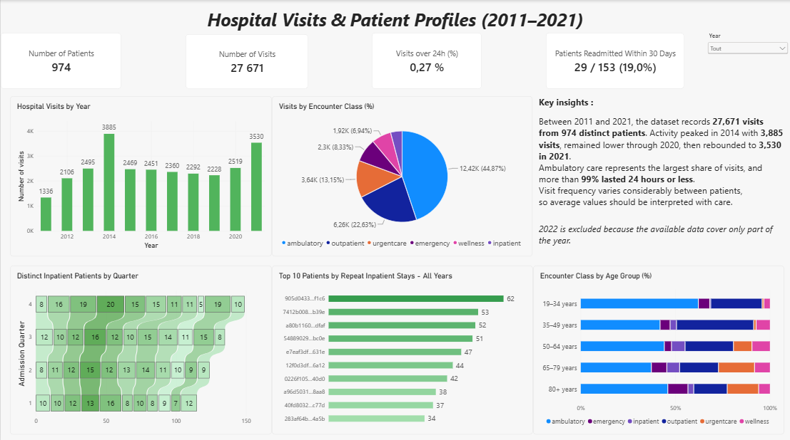
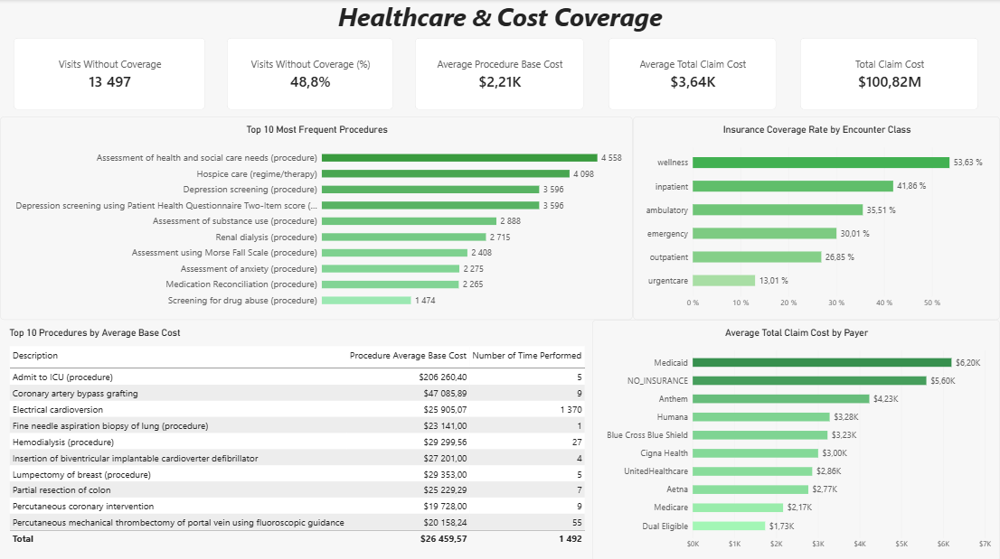

# Analyse de l’activité hospitalière

Dans ce projet, j’ai cherché à comprendre comment les visites évoluent dans le temps, quels types de soins reviennent le plus souvent et comment leurs coûts sont couverts. J’ai préparé les données dans MySQL, puis construit un rapport Power BI en deux pages : une sur les visites et les patients, l’autre sur les procédures, les coûts et les assurances.

## Aperçu du rapport

**Visites et profils des patients**

**Coûts et couverture des soins**

## Les données

J’ai utilisé le jeu [Hospital Patient Records de Maven Analytics](https://mavenanalytics.io/data-playground/hospital-patient-records), fourni par SyntheticMass. **Les patients et leurs visites sont fictifs** : ce jeu sert à s’entraîner, pas à décrire l’activité réelle d’un hôpital.

Les données d’origine vont de 2011 à 2022. J’ai écarté **2022**, car seule une partie de l’année est disponible et sa comparaison avec les années complètes serait trompeuse. Le rapport porte donc sur **2011–2021**. J’ai importé les cinq CSV dans MySQL avec l’assistant de DBeaver, puis relié les tables dans Power BI.

## Ce que montre le rapport

Sur la première page, on peut suivre les visites année par année, comparer les types de visites et voir comment ils varient selon l’âge des patients **au moment de la visite**. Le rapport distingue aussi les visites de **24 heures ou moins** de celles qui durent davantage.

Entre 2011 et 2021, les données comptent **27 671 visites pour 974 patients**. Le pic se situe en **2014, avec 3 885 visites**. Après plusieurs années moins chargées, l’activité remonte à **3 530 visites en 2021**. Les visites ambulatoires sont les plus fréquentes : elles représentent **près de 45 %** des visites. Presque toutes les visites durent 24 heures ou moins.

J’ai également regardé les retours à l’hôpital. Parmi les **153 patients** ayant eu au moins un séjour hospitalier (`inpatient`), **29** ont eu un nouveau séjour dans les **30 jours suivant la fin d’un séjour précédent du même type**, soit **19 %**. Le classement des patients par nombre de séjours répétés compte, lui, tous les séjours hospitaliers supplémentaires sur la période, **sans limite de 30 jours**.

Sur la deuxième page, je compare les procédures les plus courantes, celles dont le coût de base moyen est le plus élevé et le coût moyen des visites selon l’assureur. Une visite dite **« sans couverture »** a une valeur `Payer_Coverage` égale à zéro : cela ne veut pas forcément dire que le patient n’a pas d’assurance. Le taux de couverture affiché par type de visite correspond au **montant total payé par les assureurs divisé par le coût total des visites**. Les montants sont en dollars américains.

## Limites

Sept des dix procédures du Top 10 par coût moyen ont été réalisées moins de dix fois, dont une seule fois. Leur rang illustre ces cas précis, pas une tendance générale. Les coûts et les taux de couverture viennent d’un jeu synthétique : ils ne représentent ni les tarifs ni les pratiques d’un hôpital réel. Enfin, le fichier ne permet pas de savoir si un nouveau séjour hospitalier était prévu ou imprévu ; le chiffre des retours sous 30 jours ne doit donc pas être interprété comme un indicateur clinique de réadmission.

## Ouvrir le rapport

Le [projet Power BI](hospital%20analysis.pbip) a été réalisé avec **Power BI Desktop 2.159.1231.0**. Le fichier `.pbip` doit rester dans le même dossier que `hospital analysis.Report` et `hospital analysis.SemanticModel`.

Pour ouvrir et actualiser le rapport, téléchargez les CSV depuis la [page du jeu de données](https://mavenanalytics.io/data-playground/hospital-patient-records), créez la base `hospital_db` et ses cinq tables dans MySQL, puis importez les fichiers `patients`, `encounters`, `procedures`, `payers` et `organizations` avec l’assistant CSV de DBeaver. Les dates ISO 8601 des visites doivent être converties en `DATETIME` et les codes de motif conservés en texte. Le fichier [d’analyse SQL](sql/analysis.sql) reprend mes requêtes de travail dans une version MySQL exécutable. Le rapport se connecte à `localhost:3307` ; adaptez le serveur si nécessaire. L’import via DBeaver n’est pas automatisé dans ce dépôt.
